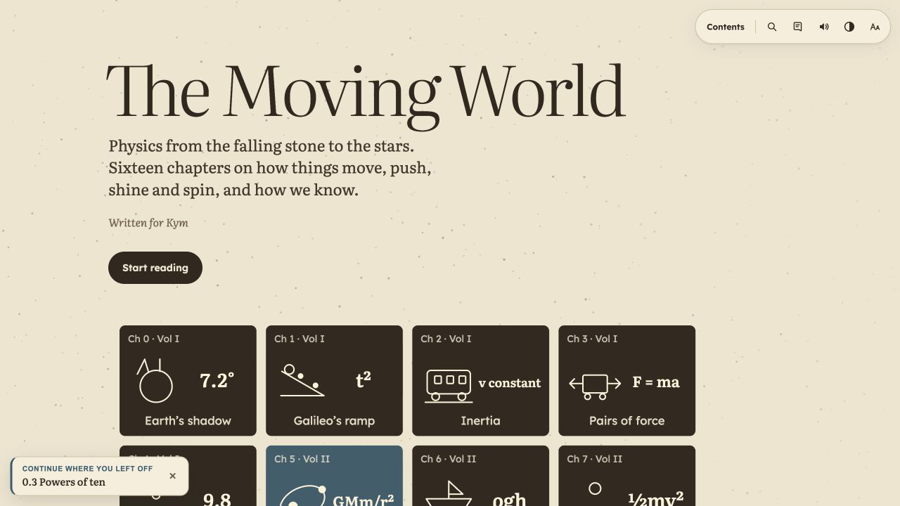
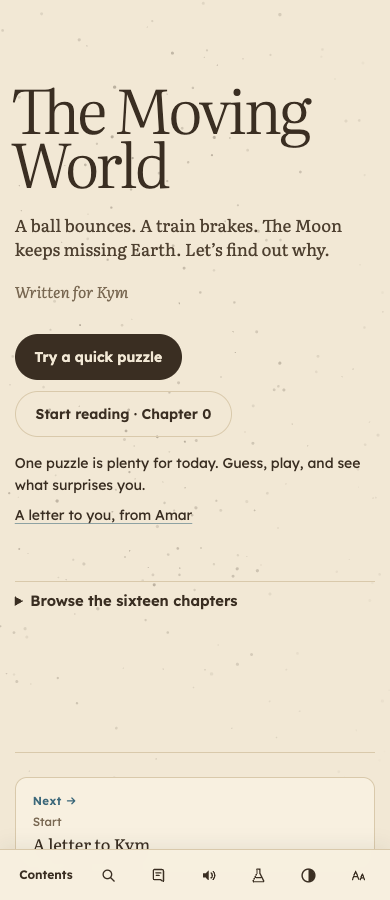
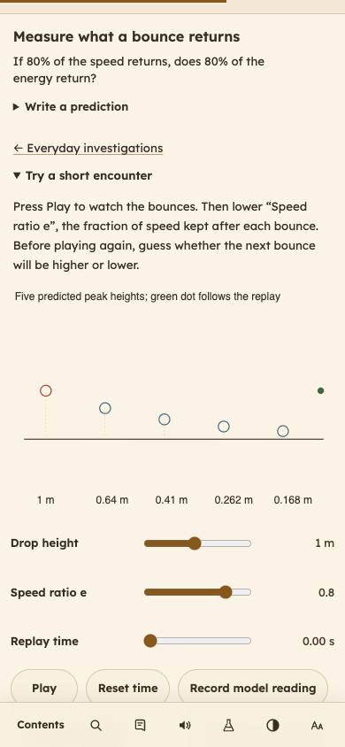
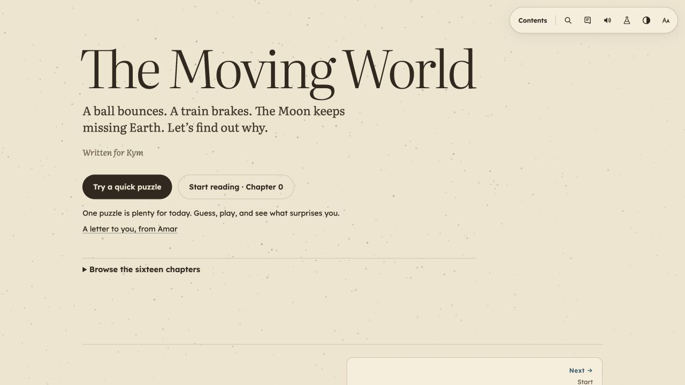
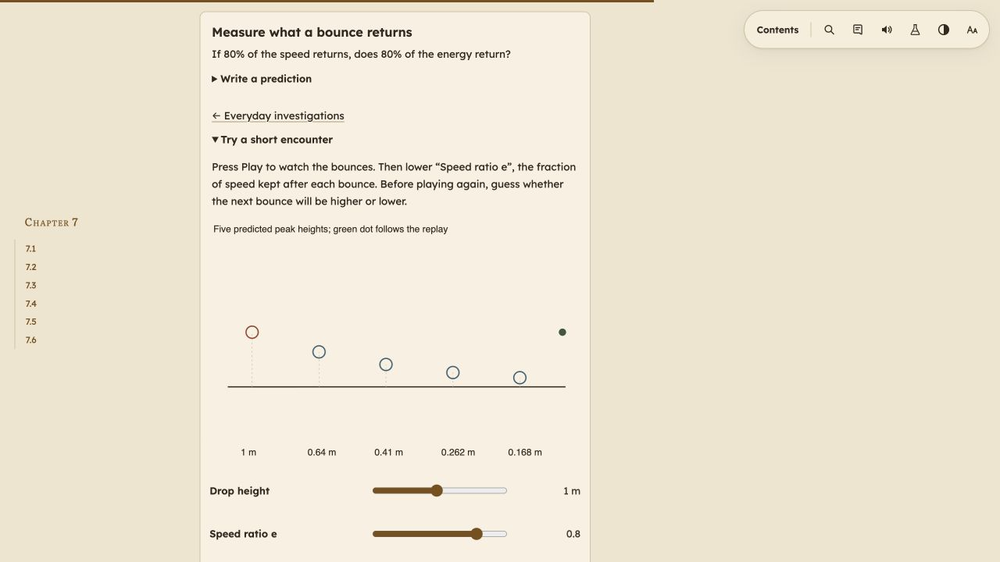

# Kymaia’s reading and experimenting journey

Reviewed 30 October 2026 for Kym, twelve, in Mumbai. The aim was a curious first visit, manageable reading steps, honest explanations and experiments that welcome unexpected results.

The two reader passes read all sixteen chapters. The independent pass scanned all 95 story files, including all 55 home-activity blocks, and fully read additional narratives where it found a concern. This was a whole-book reader review with focused fact checks, rather than a fresh validation of every unchanged historical claim. Detailed coverage and source evidence are in [the first-half report](kymaia-reader-first-half.md), [the second-half report](kymaia-reader-second-half.md), [the independent content check](kymaia-independent-review.md) and [the independent app review](kymaia-app-code-review.md).

## The reviewed steps

| Step | Experience and result |
| --- | --- |
| 1. Arrive and choose | A quick everyday puzzle and Chapter 0 are visible immediately. The sixteen formula tiles are available on request. The personal letter retains Amar’s honest note, divided into readable paragraphs. |
| 2. Find a question and read | Opening pages are separate reading units. Chapter sections in the contents unfold on request. Reviews and school wording retain their full explanations without interrupting the story. Each section offers a stopping place. |
| 3. Guess and check | Choosing a prediction leaves the answer hidden until requested. Changing a guess restores keyboard focus. Discouraging “you are wrong” wording and overpromised kitchen results are corrected. |
| 4. Play and investigate | A bouncing-ball starter precedes the catalog. No equipment or writing is required to use a model. Filters have a clear recovery action. Linked models open at their heading, and investigations have an immediate return link. |
| 5. Find, keep and listen | Search opens experiments as well as prose. Notebook keys, observations, exports and backups remain compatible. The toolbar stays available after a jump. Paper sounds are opt-in; first use offers the natural-voice download or the device voice. Opened reviews remain in narration. |
| 6. Explore and return | The four explorers retain their guides and controls. Local integration checks cover returning from a story, saved work, offline reading and lazy experiments. Hashed font assets preserve offline typography while restoring the 4 MiB document budget. |

The book’s warm paper, reading typography, historical stories and scientific depth remain its strengths. The new entry, optional repetition and small next steps make those strengths easier to reach.

The opening before the review:

The revised mobile opening and first puzzle:

## What was corrected in the book

Corrections include the sheet/page counting error, zero net force versus no force, ellipse-pin spacing, inside pressure on an inverted glass, full-body mirror geometry, magnetic-field direction and Mumbai sunlight comparison. Fridge airflow, resonance, bottle acoustics, solar tunnelling and expanding-universe analogies now state their mechanisms and limits more accurately. Unsupported salary ratios and guaranteed LED spectra were removed.

Home activities no longer invite slippery floors, standing on chairs or tables, maximal scale pulls, shorted cells, reaching behind appliances, moving a powered fan or watching lightning beside a window. Mains teaching no longer implies dry hands make a shock benign. Chapter changes are reflected in linked stories and their source ledgers. Radiation exposure, contamination and controlled food irradiation are distinguished without a blanket safety promise.

## Verification and release

All verification runs locally. `./source/check-reader.sh` repeats the release checks and does not publish. No GitHub Actions CI workflow is present or used. The existing GitHub Pages deployment publishes the separately committed static artifact.

The review covers keyboard behavior, visible focus, labels, five screen widths and three themes, search, prediction/reveal persistence, disclosure deep links, narration selection, print content, observation editing, invalid input, CSV/Markdown/JSON exports, backup restoration, storage fallback and offline behavior. It does not certify complete accessibility, physical sensors, household apparatus, speech quality or Kymaia’s comprehension; those need a real learner and device trial.

[The verification receipt](kymaia-verification.json) records exact counts, artifact hashes, deployment evidence and screenshots. The incoming live index matched `origin/main` exactly, so no direct live edits were overwritten. For rollback, the previous public static artifact is available in commit `f2a005e233d4c8b09914a4d37dd2d191b5d971f6`; restore its generated delivery files and publish them as a new commit, then verify its service-worker hash. Notebook data uses the same browser keys throughout.

## Published result

Published at [The Moving World](https://saxster.github.io/kym-physics/). The live index SHA-256 matches the final local artifact, and all 76 precached delivery files match byte for byte. A controlled replay of the captured previous live index/cache upgrades to the new cache and removes the old one; a previously unopened lesson works after an offline reload. Retained demonstrations work at 390 and 1440 px. The full reader journey also passes live at five widths and three themes with no relevant browser errors. The original in-app-browser visit was reloaded into the new edition, and its starter puzzle was opened and played.

The complete catalog check covers 252 mobile/desktop cases: 240 passed the original raster check, and twelve text-only calculation cases passed the corrected narrow label check on rerun. The six exceptions still reject hidden labels; other scenes still require drawn marks. Local checks also passed nineteen Node test files, four catalog checks, three build-integrity checks, the new reader and narration journeys, existing investigation/export/storage/offline integration, 36 original live figures and four explorers. The main document is 3,984,873 bytes, below the 4 MiB budget.

