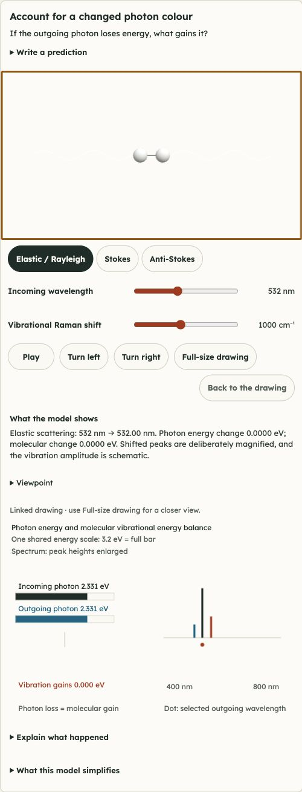
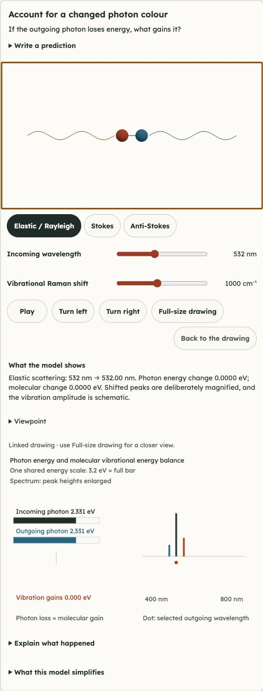

# Demonstration visual audit — 29 October 2026

Scope: all 109 newly added demonstrations on the public textbook, with default and deliberately changed states at 390×844 and 1440×1000 CSS pixels. This audit is separate from the earlier numerical and publication reports. It uses fresh screenshots captured during this request.

## Work and verification sequence

1. **Inspect the live baseline.** Capture all 109 × two widths × two states, save UI/control metadata, and personally inspect each subject group's paired screenshots. Complete: 436 images and 109 paired boards. The live index matches the committed production root before editing.
2. **Fix the demonstrated gaps.** Keep the question visible; place controls beside the experiment; improve labels, callout placement and camera framing; remove controls with no effect; synchronise clocks and preset states; fix physics/geometry discrepancies documented in the domain registers.
3. **Verify the physics independently.** Check numerical limits, shared scales, conservation, geometry and actual renderer controls. A reviewer who did not author each domain checks its changes against the grounding notes and cause-first teaching requirements. Source tests do not establish visual acceptance.
4. **Inspect the candidate.** Reopen every demonstration at both widths. Read the question, visible evidence, measurements and explanation; operate a meaningful control; inspect the saved screenshot. Fix any obscured evidence or confusing state, then recapture affected views. Complete for all 109 lessons at both widths, with targeted fresh recaptures for subsequent fixes. The final strict preflight records actual viewport, sepia theme, no opening transition and no stage transform on every shot.
5. **Publish and verify the live result.** Commit the checked source and generated production files, push main, await the exact GitHub Pages revision, compare live index/cache/chunks with the candidate, and capture the final live demonstration matrix. Pending.

## Detailed registers

- [Mechanics: all 42 demonstrations](visual-audit-mechanics.md), [machine-readable ledger](visual-audit-mechanics.json).
- [Thermal, waves and optics: all 34 demonstrations](visual-audit-waves.md), [machine-readable ledger](visual-audit-waves.json).
- [Fields, sky and modern physics: all 33 demonstrations](visual-audit-fields.md), [machine-readable ledger](visual-audit-fields.json).

## Shared fixes and additional checks

Controls now sit directly below the primary model, the prediction question is always unfolded, and observations precede the linked drawing. Readable diagram headings and captions have their own space; numeric ticks retain their anchors. Three-dimensional callouts have collision handling and authored clearance where needed. Original drawing captions return when the lesson closes and when printing.

Static studies hide playback; mode-specific controls are disabled where they do not apply. Time controls, presets and reset actions agree with the displayed state. Fixed motion envelopes prevent clipping during a replay. The domain registers describe the numerical and representational corrections, including diode polarity, common energy/pressure/volume scales, force visibility, mirror paths, tracked parcels and elapsed-hour wording.

The coordinator personally inspected 27 additional theme/responsive cases across 390, 820, 1024, 1180 and 1440 px. Light and dark themes exposed a real wide-gamut colour failure: three.js rejected CSS Color 4 strings and rendered coloured evidence white. A memoized native sRGB conversion fixes it; the browser supplies the conversion defined by the [HTML canvas standard](https://html.spec.whatwg.org/multipage/canvas.html#color-spaces-and-color-space-conversion).

| Light theme before colour fix | Corrected candidate |
|---|---|
|  |  |

Normal clicks and keyboard checks also verified prediction/explanation persistence after closing and reopening, full-size drawing focus and horizontal keyboard scrolling without page-wide overflow, and a finite circular-release animation stopping at its endpoint. Source tests and actual browser checks are distinguished in the verification receipt.

## Evidence and limits

Fresh full-card photographs, paired review boards and control metadata are in `source/build/visual-audit-20261029/`. Baseline, candidate and final live evidence are kept separately. Viewport dimensions are asserted from DOM metadata; filenames alone are insufficient. A thin horizontal reading-progress bar and occasional fixed reading toolbar appear inside some long-card captures; they are browser-page reading chrome, not scientific lines.

These are browser viewport checks, not claims of testing physical phones or full screen-reader/accessibility conformance. Numerical/renderer tests, visual inspection and live deployment checks are reported separately. The previous publication remains the rollback reference until the corrected build passes its gates.
